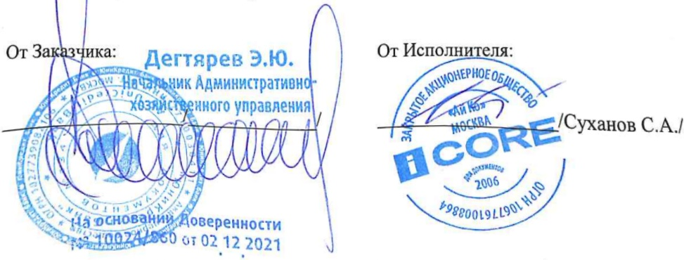

# AKT №91 приемки Проектных работ  по Договору № 850/01/2022 от 01 февраля 2022г.

### г. Москва

28 апреля 2022 года

AO ЮниКредитБанк,именуемоеB дальнейшем«Заказчик»,B лице

действующего на основании

с одной стороны и

ЗАО «Ай Ко», именуемое в дальнейшем «Исполнитель», в лице Финансовогодиректора Суханова Сергея Александровича действующего на основании Доверенности №02/12 от 22.12.2021г., с другой стороны, составили настоящий Акт о нижеследующем:

1. В период с 01.02.2022г. по 28.04.2022г. Исполнитель выполнил следующие Работы:

<html><body><table border="1"><tr><td>No</td><td>наименование работ</td><td>цена с НДС, py6.</td><td>стоимость с HДС,рy6.</td></tr><tr><td>1.</td><td>Система кондиционирования(Ск)</td><td>393600,00</td><td>393 600,00</td></tr><tr><td>2.</td><td>Силовое электроснабжения(ЭОм)</td><td>427200,00</td><td>427200,00</td></tr><tr><td>3.</td><td>Автоматизация и диспетчеризация(АСдУ)</td><td>515 200,00</td><td>515200,00</td></tr><tr><td>4.</td><td>Автоматическое газовое пожаротушение (АГПТ) (АПС)</td><td>116800,00</td><td>116 800,00</td></tr><tr><td>S</td><td>Структурированная кабельная система (СКС)</td><td>290 400,00</td><td>290 400,00</td></tr><tr><td>6.</td><td>Система фальшполов(ФП)</td><td>56800,00</td><td>56800,00</td></tr><tr><td>7.</td><td>Архитектурно-строительные решения (АР)</td><td>236 800,00</td><td>236 800,00</td></tr></table></body></html>

2. Общая стоимость Проектных работ составляет 2 036 800 (Два миллиона тридцатьшесть тысяч восемьсот) рублей О0 коп., в т.ч. НДС (20%) в размере 339 466 (Тристатр мееннь ньь* ехьрееха шоогвдооае шоохь сеуо—тридцать девять тысяч четыреста шестьдесят шесть ) рублей 67 коп.

3. Работы выполнены Исполнителем и приняты Заказчиком в полном объёме и,..,я…соответствуют условиям Договора.

4. Стороны взаимных претензий не имеют.

—__г.

силу, по одному для каждой Стороны.

