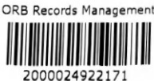
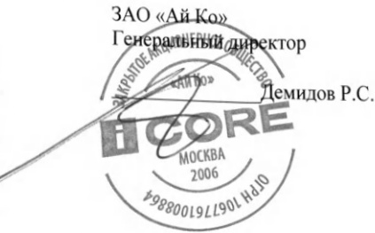
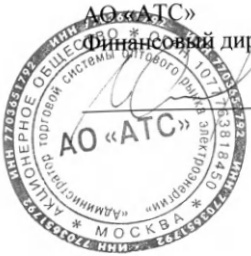

# AKT № 87 об оказании Услуг  за период с 01.01.2020 г. по 31.03.2020 г.

### г. Москва

31 марта 2020 г.

Акционерное общество «Администратор торговой системы оптового рынка электроэнергии»(АО «АТС»), влице Финансового директора Селивахина Ивана Анатольевича, действующего на основании Доверенности №01-07/19-249 от 30.12.2019, с одной стороны, и Закрытое акционерное общество «Ай Ко» (3АО «Ай Ко», влице Генерального директора Демидова Руслана Станиславовича, действующего на основании Устава,именуемое в дальнейшем «Исполнитель», с другой стороны, далее вместе именуемые «Стороны», а каждая поотдельности «Сторона», составили настоящий акт о нижеследующем:

1. Исполнителем по поручению Заказчика оказаны Услуги по обеспечению исправности и работоспособностиОборудования и Услуги по обеспечению непрерывной работоспособности Компонентов виртуальнойинфраструктуры в соответствии с Перечнем обслуживаемого оборудования (Приложение № 5 к Договору №2019/68 от 22 августа 2019 г.) и Перечнем обслуживаемых Компонентов виртуальной инфраструктуры(Приложение № 6 к Договору № 2019/68 от 22 августа 2019 г.)

2. Заказчик подтверждает оказание Исполнителем Услуг по обеспечению исправности и работоспособностиОборудования и Услуг по обеспечению непрерывной работоспособности Компонентов виртуальнойинфраструктуры, полный перечень которых приведен в Приложении № 1 и Приложении № 2 к данному акту.

3. Стоимость оказанных Услуг рассчитывается как совокупная стоимость обслуживания всех единицОборудования (стоимость обслуживания каждой единицы Оборудования приведена в Приложении № 1 кданному акту) и Компонентов виртуальной инфраструктуры (стоимость обслуживания каждого Компонентавиртуальной инфраструктуры приведена в Приложении № 2 к данному акту) и составляет 84 045 374(Восемьдесят четыре миллиона сорок пять тысяч триста семьдесят четыре) руб. 75 коп., включая НДС 20% 14 о07 562 (Четырнадцать миллионов семь тысяч пятьсот шестьдесят два) руб. 46 коп.

4.Взаимных претензий по результатам оказания Услуг Стороны не имеют.

5. После подписания Сторонами настоящего акта следует к перечислению 84 045 374 (Восемьдесят четыремиллиона сорок пять тысяч триста семьдесят четыре) руб. 75 коп., включая НДС 20% - 14 007 562(Четырнадцать миллионов семь тысяч пятьсот шестьдесят два) руб. 46 коп.

6. Настоящий акт составлен в двух экземплярах, имеющих одинаковую юридическую силу, по одному длякаждой из Сторон.

ИСПОЛНИТЕЛЬ:

ЗАКАЗЧИК:

Селивахин И.А.

